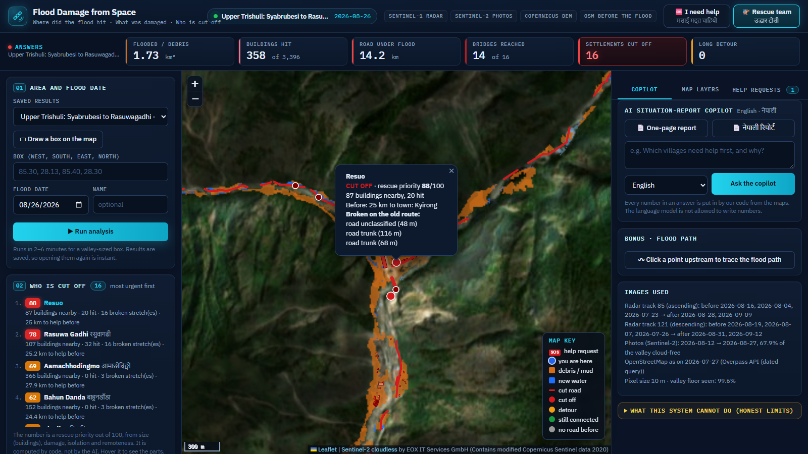

# Flood Damage from Space

**Multimodal AI Hackathon 2026 · Track B: Mapping Flood Damage from Space**

**Author:** Suraj Mishra

When roads, bridges and phone lines are gone, rescuers still need to know where the damage is and who is cut off. This system tells them, from space, for **any area and any flood date**:

1. **Where did the flood hit?** Flooded and debris-covered ground from Sentinel-1 radar (sees through clouds), checked with Sentinel-2 photos when the sky is clear.
2. **What was damaged?** OpenStreetMap buildings, roads and bridges *as they were before the flood*, overlaid on the flood map.
3. **Who is cut off?** Villages that lost every road connection to a town or hospital, with the broken road or bridge that caused it.

On top of that:
- **AI copilot:** answers rescuers' questions and writes one-page situation reports in **English and Nepali**. The language model never writes a number; our code inserts every number from the maps.
- **Map dashboard:** draw a box, pick a date, click Run. Village names, place names and a map key that switches each layer on or off.
- **Evidence, below the dashboard** (scroll down): the radar images before and after (drag to compare), the check against the official EMS map, the no-flood test, the other floods, and the AI's own words before our code fills in the numbers.
- **Home page:** a short film (the Earth from space, a radar ping on the Trishuli valley, a wall of flood water, the title), then the dashboard opens by itself with the Trishuli result.
- **Bonus:** trace a flood path downhill from any upstream point.
- **Two sides on one map:**
  - **Rescue priority:** cut-off villages are ranked 0–100 by code (40% size, 30% damage, 20% isolation, 10% remoteness), most urgent first.
  - **Rescue team:** the analysis, plus a live inbox of help requests (behind a PIN), most urgent first. Each request shows its coordinates and GPS accuracy, with Copy, Directions and Call buttons and Seen / Team sent / Helped. Danger levels are checked again whenever a new analysis covers the place.
  - **I need help:** emergency numbers for Nepal and India (tap to call). People can check their place by GPS, by typing a village name, or by tapping the map. Our maps say whether it is in or near the flood, or cut off, in English or Nepali. With their consent, they can send their location to the rescue team. The danger level comes from our maps, never from the sender or a language model. Open it directly with `/?mode=help`.
  - **Anti-fraud rule:** a request is accepted only if the phone's GPS, read again when Send is tapped, is inside a mapped flood area. A typed or tapped place must be within 3 km of the phone. The server enforces this, not just the page. Someone in Delhi typing "Timure" is refused and shown the emergency numbers instead.

> Educational prototype, not an operational tool. Built with respect for the people affected by the August 2026 Trishuli flood; no images of victims are used anywhere.



---

## Quick start (Windows, macOS or Linux)

### 1. What you need
- **Python 3.12** and an internet connection.
- **Free accounts / keys:**

| Key | Used for | Where to get it | Needed? |
|---|---|---|---|
| `CDSE_CLIENT_ID` + `CDSE_CLIENT_SECRET` | Sentinel-1/2 images (Copernicus Data Space, Sentinel Hub API) | [dataspace.copernicus.eu](https://dataspace.copernicus.eu) → [dashboard](https://shapps.dataspace.copernicus.eu/dashboard/#/account/settings) → OAuth clients → Create | Recommended. Without it, set `DATA_SOURCE=pc`. |
| `OHSOME_API_KEY` | OpenStreetMap as it was before the flood | [account.heigit.org](https://account.heigit.org/signup) (Standard plan) | Recommended. Without it, a slower Overpass dated query is used. |
| `GROQ_API_KEY` | AI copilot (English + Nepali) | [console.groq.com/keys](https://console.groq.com/keys) | Optional. Without it, a fixed template writes the reports. |
| `RESCUE_PIN` | PIN the rescue team types to see help requests (names, phones, locations) | Choose any number | Recommended if the dashboard is shared. Without it, the inbox is open. |

The height data (Copernicus DEM GLO-30) needs no key.

### 2. Install
```bash
python -m venv .venv
# Windows:            .venv\Scripts\activate
# macOS / Linux:      source .venv/bin/activate
python -m pip install -r requirements.txt
cp .env.example .env        # Windows: copy .env.example .env
```
Then open `.env` and paste your keys. Never upload `.env`; it is already in `.gitignore`.

### 3. Run the dashboard
```bash
python -m uvicorn web.app:app --port 8000
```
Open **http://localhost:8000** (the home page plays its short film, then opens the dashboard; the dashboard alone is at `/app`). On Windows you can also just double-click `start.bat`.

The main case study (Upper Trishuli, 26 August 2026) is included in `runs/`, so the map is full straight away. Draw a box on the map → pick the flood date → **Run analysis** to map a new area. A valley-sized box (~200 km²) takes about 1.5 minutes the first time; saved results open instantly.

### 4. Or use the command line
```bash
python -m floodmap run --bbox 85.30,28.13,85.40,28.30 --date 2026-08-26 --name "Upper Trishuli"
python -m floodmap floodpath --lon 85.375 --lat 28.272 --date 2026-08-26
```
Each run writes to `runs/<run_id>/`:
- `facts.json`: every number
- `layers/*.geojson`: map layers
- `sitrep_en.html` / `sitrep_ne.html`: one-page reports
- `rasters/flood_class.tif` and `rasters/flood_conf.tif`

### 5. Run the tests
```bash
python -m pytest
```
20 quick checks, also run by GitHub on every push (`.github/workflows/tests.yml`). They never call the language model and never touch real help requests:
- the copilot: any digit or number word written by the model is rejected, and our code fills in the real numbers (English and Nepali);
- rescue priority: always 0–100, more damage and isolation rank higher, most urgent first, and a known village keeps its score;
- the "I need help" side: a phone outside every mapped flood area, or far from the chosen place, is refused; the inbox needs the PIN and locks after ten wrong tries; the public counter shows no names, phones or places;
- the live link: limits per visitor, and secret files (`.env`) cannot be downloaded;
- the pages open where they should, and the evidence numbers match the report and the saved result.

### 6. Serve it live (Windows, for the judges)
Double-click **`serve_live.bat`**. It opens three windows and restarts each one by itself if it stops:
1. the server (`tools/live_server.bat`), which tells visitors apart behind the tunnel (`--proxy-headers`);
2. an [ngrok](https://ngrok.com) tunnel (`tools/live_tunnel.bat`) on your free permanent address: put it in `.env` as `NGROK_DOMAIN=` (your address is in the ngrok dashboard under Domains);
3. "keep awake" (`tools/keep_awake.ps1`), so Windows does not go to sleep. Keep the laptop plugged in, online and with the lid open.

It refuses to start without a `RESCUE_PIN`. On the live link, each visitor can ask the copilot 20 questions per 10 minutes, start 4 new analyses per hour and send 10 help requests per hour, and only this computer can redo a finished result. The free ngrok plan allows 1 GB and 20,000 requests a month and shows visitors a "Visit Site" notice first; one full visit (film, dashboard and evidence) is about 10 MB.

---

## How it works

```
Area + flood date
  ├─ 1. Find images   Sentinel-1: up to 3 passes before + 2 after on the SAME track, ascending and descending
  │                   Sentinel-2: the clearest image before and after (cloud-free share of the valley)
  ├─ 2. Height data   Copernicus DEM 30 m → river network, HAND (height above nearest river), slope,
  │                   radar blind spots (layover / shadow) for each viewing direction
  ├─ 3. Flood map     radar change score (|ΔVV|+|ΔVH|, speckle-filtered, multi-image, both tracks)
  │                   + optical check (NDVI drop, ground turned bare, new water MNDWI)
  │                   → new water / debris-mud with HIGH / MEDIUM / LOW confidence, valley floor only
  ├─ 4. Damage        OSM buildings, roads, bridges (snapshot BEFORE the flood) × flood map
  ├─ 5. Cut-off       road network graph; remove flooded roads and bridges; shortest routes to towns,
  │                   hospitals and roads leaving the area, before vs after → CUT OFF / DETOUR + cause
  ├─ 6. facts.json    every number in one place
  ├─ 7. Copilot       Groq LLM writes text with {placeholders}; a checker rejects any digit or number
  │                   word; code fills in the values; template fallback
  └─ 8. Dashboard     FastAPI + Leaflet map, layers, lists, reports, chat, flood path
```

**Data rules (followed strictly):**
- **Inputs are only** Sentinel-1, Sentinel-2, Copernicus DEM, and OpenStreetMap as it was **before** the flood.
  - The OSM snapshot date is the day before the flood, or the newest ohsome data if that is older.
  - Example of why this matters: around Syabrubesi, OSM had 392 buildings on 27 Jul 2026 but only 225 in October, because mappers deleted destroyed buildings after the flood.
- **Copernicus EMS maps are never an input.** They sit in `validation/` and are read only by `tools/compare_emsr927.py`, after a run, to score it.
- **The method settings** (`floodmap/config.py`) were chosen from physical reasoning and from our own radar-vs-photo self-check in the upper valley, **before** the EMS comparison. They were not tuned to EMS.

---

## Case study: August 2026 Trishuli flood vs Copernicus EMS EMSR927

Our system ran on boxes around each EMS area with flood date 2026-08-26 (Copernicus images). It used radar from 16 Aug → 28 Aug (ascending) and 24 Aug → 5 Sep (descending), plus photos from 12 Aug → 27 Aug.

| Area | EMS km² | Ours km² | Precision | Recall | F1 | F1 (20 m tolerance) | EMS-destroyed buildings found | EMS bridges on our flood |
|---|---|---|---|---|---|---|---|---|
| Syabrubesi | 1.11 | 0.41 | 1.00 | 0.37 | 0.54 | 0.73 | 88% | 5 of 5 |
| Timure | 1.29 | 0.43 | 1.00 | 0.33 | 0.50 | 0.72 | 82% | 1 of 1 |
| Bidur | 7.01 | 5.09 | 0.94 | 0.68 | 0.79 | **0.92** | 98.5% | 25 of 26 |
| Phosretar | 6.39 | 2.70 | 0.99 | 0.42 | 0.59 | 0.74 | 79% | 12 of 22 |
| **All (pooled)** | 15.8 | 8.6 | **0.96** | 0.52 | 0.68 | – | – | – |

**What this means:**
- **Almost no false alarms:** 96% of what we map is inside the EMS damage area.
- **We find most destroyed buildings** and nearly all destroyed bridges.
- **We under-map the outer edge of the debris.**
  - In the narrow upper gorge, about 31% of the EMS area lies outside the valley floor we check, because the 30 m height model makes it look too high or too steep.
  - EMS used 0.3–0.7 m images; we use 10 m pixels.

Full numbers: [`report/case_study_emsr927.md`](report/case_study_emsr927.md). Maps: `report/figures/emsr927_*.png`.

**Also tested, unchanged, on four other floods.** These checks confirm the system runs end-to-end and gives sensible answers; they were not scored against reference maps.

| Flood | Result |
|---|---|
| Rasuwa GLOF, 8 Jul 2025 | radar only; found the destroyed "Rasuwa Bridge" |
| Teesta GLOF, Sikkim, Oct 2023 | 9 North Sikkim Highway bridges reached; Dikchu cut off |
| Chamoli, Feb 2021 | runs end-to-end (see report section 5) |
| Barak river, Silchar, Jun 2022 | flat floodplain, 103 km² flooded |
| **No-flood control:** Upper Trishuli, 15 Apr 2026 (dry season) | 0.06 km² flagged, 0 bridges, **0 villages cut off** (real flood: 1.73 km², 14 bridges, 16 cut off) |

---

## Limitations (what it cannot do)
- **No early warning.** Sentinel-1 passes each track only every few days. It maps damage after the fact and cannot warn of a glacier collapse minutes ahead.
- **10 m pixels** miss small houses, narrow roads and footbridges.
- **Steep gorges:**
  - Radar can't see some slopes (layover / shadow).
  - The 30 m height model is rough, so we under-map debris edges.
- **Only the valley floor is checked.** Landslides high on slopes are not mapped.
- **"Hit" means touched by the flood, not destroyed.** We do not grade damage.
- **OpenStreetMap gaps:**
  - Missing buildings, roads or villages mean missing answers.
  - Footpaths, trails and footbridges are not part of the road network.
  - Roads outside the box are assumed open.
- **Clouds:** in the monsoon, photos are often unavailable and the map is radar-only. Radar-only maps are less accurate in vegetated gorges.
- **Copilot:** it can only report what the maps contain. It says when something is unknown, such as casualties or population.
- **Help requests are a demo:**
  - They are saved on this computer (`helpdesk/`, not uploaded to GitHub) and shown on the Rescue team screen. Nothing reaches a real government service.
  - They are protected by one shared PIN (`RESCUE_PIN`), not by real user accounts. The "I need help" side only ever receives counts, never other people's details.
  - "No flood mapped near you" does not mean "safe": the map is only as new as the last satellite image.
  - The anti-fraud rule has a cost. A real person outside every mapped area cannot send a request; they see the emergency numbers instead. It also stops casual fakes only: GPS can be faked with special apps.

---

## Project structure
```
floodmap/          the system (Python)
  sources/         image sources: cdse.py (Copernicus Sentinel Hub), pc.py (Planetary Computer backup)
  dem.py           height data, rivers, HAND, slope, radar blind spots, flow paths
  flood.py         radar + optical change detection and confidence
  osm.py           OpenStreetMap before the flood (ohsome API v2; Overpass dated query as backup)
  damage.py        buildings hit
  network.py       road network, cut-off and detour analysis
  copilot.py       AI copilot with the number checker
  sitrep.py        one-page situation reports (EN + NE)
  floodpath.py     bonus flood-path tracer
  safety.py        "I need help": danger check for one place + place search
  pipeline.py      one complete run
web/               dashboard (FastAPI + Leaflet); helpdesk.py stores help requests
  static/home/     the home page film (three.js) and its Earth pictures
  static/evidence/ pictures and numbers for the evidence section
tests/             automated tests (python -m pytest)
tools/             compare_emsr927.py (case-study scoring, reads validation/, checking only),
                   make_evidence.py, make_home_textures.py, live server / tunnel / keep-awake helpers
runs/              saved results; the main case study is included (licences in runs/README.md)
report/            report, case-study results, figures
serve_live.bat     serve the dashboard on the internet for the judges
```

---

## Required attributions
- Contains modified Copernicus Sentinel data 2026 (and the years of any other dates you run).
- Produced using Copernicus WorldDEM-30 © DLR e.V. 2010–2014 and © Airbus Defence and Space GmbH 2014–2018 provided under COPERNICUS by the European Union and ESA; all rights reserved.
- © OpenStreetMap contributors. Data under ODbL. OSM extracts are downloaded at run time and are not stored in this repository; the map layers of the included case study (`runs/fb7507902568/layers`) are derived from them and shared under ODbL (see `runs/README.md`).
- Case-study comparison: European Union, Copernicus Emergency Management Service data (EMSR927).
- Backup imagery source: Microsoft Planetary Computer (Sentinel-1 RTC, Sentinel-2 L2A); same Copernicus Sentinel data.
- Dashboard background picture: Sentinel-2 cloudless – https://s2maps.eu by EOX IT Services GmbH (Contains modified Copernicus Sentinel data 2020), CC BY-NC-SA 4.0. It is shown only as a picture behind the map; the analysis never reads it. It is from 2020, before every flood we tested.
- Home page film (pictures only): the Earth is made from Sentinel-2 cloudless 2020 by EOX IT Services GmbH (contains modified Copernicus Sentinel data 2020), CC BY-NC-SA 4.0; clouds and night lights from NASA Earth Observatory (Blue Marble, Black Marble 2016; public domain); relief shading from Terrain Tiles (Mapzen, AWS Open Data). See `tools/make_home_textures.py`.
- Place names on the dashboard (pictures only, today's map; the analysis never reads them): Esri World Boundaries and Places (Esri, HERE, Garmin, © OpenStreetMap contributors) and the EOX overlay (© OpenStreetMap contributors, rendering © EOX).
- No training dataset is used. We chose the situation-report copilot as the AI component, not a trained segmentation model.

## AI tools used (disclosure)
This project was built with help from **Claude Code (Anthropic)**, an AI coding assistant.
- **AI-assisted:** almost all of the Python and JavaScript code, the radar/optical method experiments, the dashboard design, the home page film, the evidence section, the tests, and first drafts of this README and the report.
- **Done by the author, Suraj Mishra:**
  - chose the problem, the track and the design decisions (for example the "I need help" side and its anti-fraud location rule);
  - created all accounts and keys;
  - tested the system on PC and phone, found problems, and reviewed the results;
  - edited the documents.

The runtime AI component uses **Groq** (`openai/gpt-oss-120b`) to write the copilot's text. Every number in that text is inserted by our code, never by the model.

## Licence
Code: MIT (see `LICENSE`). Data keeps its own licences (see attributions).
